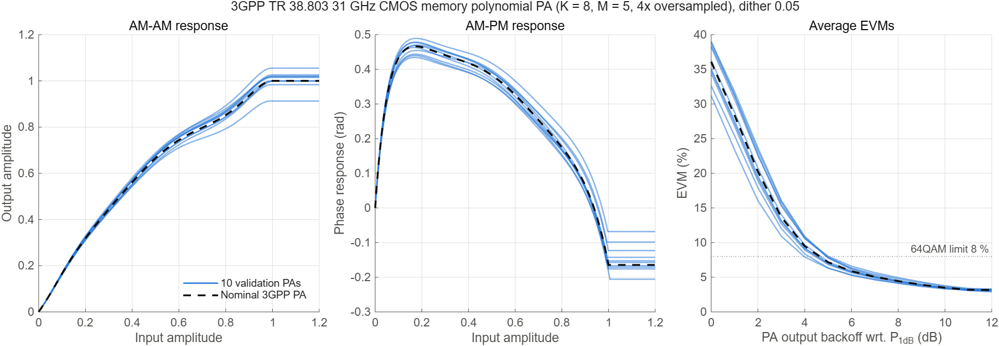
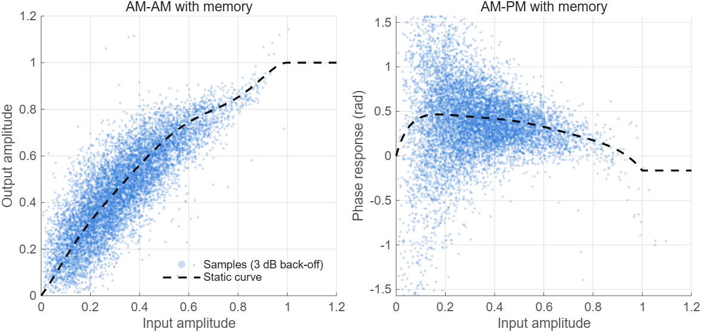

# MPPA: the 3GPP memory polynomial PA

`PAModel = 'mp3gpp'` is a transmit power amplifier **with memory**, built from the
memory polynomial model of **3GPP TR 38.803 (v14.5.0), Annex A.1 B)** and set up like the
PA of **Pihlajasalo et al., "Deep Learning OFDM Receivers for Improved Power Efficiency
and Coverage", IEEE TWC, Aug. 2023** (Sec. IV-A, Table II, Fig. 4). The paper fitted a
17th-order polynomial to a measured 28 GHz PA, but its coefficients are not published.
Here the PA comes from 3GPP, and the paper's method is applied to it: dithered PAs,
a validity check, output back-off relative to P1dB, and separate training and
validation PAs.

The memoryless amplifiers from before (`'rapp'`, `'polynomial'`) are now called
**miniPA** (`tx.miniPA`) and are unchanged.

## 1. The 3GPP model

The TR gives two memory polynomial (MP) PAs:

$$y(n)=\sum_{k=1}^{K}\sum_{m=0}^{M-1} a_{km}\,x(n-m)\,|x(n-m)|^{k-1}$$

| TR model | Signal | K | M | NMSE of the fit | Used |
|---|---|---|---|---|---|
| Intel PA, 2.44 GHz (measured) | OFDM | 5 | 5 | −67 dB | no: compresses only 1 dB at \|x\| = 0.04 and never saturates over the range tested (\|x\| up to 0.6), and its input range is unknown |
| **28 nm CMOS PA at 31 GHz (KU Leuven)** | 16-QAM single carrier | 8 | 5 | −39 dB | **yes**: mmWave like the paper's PA, with clear saturation and AM/PM |

The TR lists the 40 coefficients as one vector. **I took it as k-major**: the 5 taps of
k = 1, then those of k = 2, and so on. With that order the k = 1 taps form a sensible
linear filter. The other order (m-major) gives a small-signal gain of 1.8·10⁵, which is
nonsense. The coefficients are typed into `tx.mppa_nominal`, verbatim from
`docs/38803-e50.docx`:

| k | m = 0 | m = 1 | m = 2 | m = 3 | m = 4 |
|---|---|---|---|---|---|
| 1 | −10.0624+14.6485i | 24.6983−25.5192i | −28.6702+24.4684i | 18.9709−12.0500i | −5.3080+2.4235i |
| 2 | −63.1123+9.4912i | −18.2854−9.0971i | −33.6220−0.1089i | 28.2194−25.5253i | −16.7754+26.7834i |
| 3 | 1.2797e3−1.9632e2i | 5.6546e2+1.4583e2i | 6.7368e2−6.4518e1i | −1.0422e3+7.0243e2i | 5.1510e2−6.8161e2i |
| 4 | −1.1576e4+9.9815e2i | −8.6173e3−6.5709e2i | −5.8579e3+1.7786e2i | 1.4834e4−8.9848e3i | −7.2260e3+8.4931e3i |
| 5 | 5.7725e4−1.6098e3i | 6.1271e4+2.1093e3i | 3.0381e4+1.1418e3i | −1.1167e5+6.4821e4i | 5.6209e4−5.9278e4i |
| 6 | −1.5194e5−5.1975e3i | −2.3711e5−1.8474e3i | −8.7976e4−1.4443e4i | 4.5408e5−2.5881e5i | −2.4165e5+2.3195e5i |
| 7 | 1.8482e5+2.2474e4i | 4.7763e5−9.1215e3i | 1.3200e5+5.0018e4i | −9.4830e5+5.3597e5i | 5.3878e5−4.7644e5i |
| 8 | −6.4854e4−2.2706e4i | −3.9248e5+1.9477e4i | −7.9196e4−5.8301e4i | 7.9804e5−4.4917e5i | −4.8561e5+4.0015e5i |

The TR states **no sample rate and no input range** for either MP model. (Its statement
"normalized … 0 ≤ |x| ≤ 1, gain 1" is about its GMP models only.)

## 2. Normalization

The static curve is what a constant input gives through all taps:
$v(u)=\sum_k g_k u^k$, with $g_k=\sum_m a_{km}$ (`tx.mppa_curve`). Its first AM/AM
peak is at |x| = **0.3797**, where the output is **1.0390**. The model is rescaled so
saturation sits at input 1 and output 1, and its small-signal gain has zero phase:

$$B_{km} = a_{km}\,\frac{0.3797^{\,k}}{1.0390}\,e^{-j\angle g_1},\qquad
v(n)=\sum_k\sum_m B_{km}\,u(n-m)\,|u(n-m)|^{k-1}$$

`test_mppa` checks that this reproduces the TR model to within 3·10⁻¹².

**Saturation.** Past |u| = 1 the polynomial is outside the fitted range and blows up
(+29 dB at 1.5× the saturation input). As the paper does ("imposing an applicable
saturation level"), the input amplitude is held at the saturation input, so the output
stays flat at saturation.

Static characteristics of the nominal PA (normalized):

| Quantity | Value |
|---|---|
| Saturation | input 1, output 1 |
| 1 dB compression (P1dB) | input 0.538, output 0.699 |
| Psat above P1dB | 3.10 dB |
| Small-signal gain expansion | +1.1 dB, peaking near input 0.115 |
| AM/PM | rises to +0.47 rad (27°) near input 0.17; +21° at P1dB; −0.16 rad at saturation |

## 3. Sample rate: 4× oversampling

The k = 1 taps form a linear filter. Its response is flat to within ±3 dB only for
|ω| < 0.25π and reaches +29 dB at the band edge. So the model is only meaningful when the
signal fills the middle quarter of the band, which means it was extracted at **4× or more
oversampling**. At our 61.44 MHz the 792 subcarriers fill ±0.77π, where the model means
nothing. `tx.mppa` therefore:

1. upsamples the slot by `PAOversampling` = 4, to 245.76 MHz, where the signal fills ±0.19π
   (`resample`);
2. applies the PA there;
3. low-pass filters and decimates back to 61.44 MHz.

The memory then acts on the signal as it did in the TR's measurement, relative to its
bandwidth. The oversampling factor sets how strong the memory is. The static curve is the
same for every factor; memory adds distortion under heavy drive, and that extra fades as
the factor grows:

| EVM, nominal PA | −1 dB | 0 dB | 3 dB | 6 dB | 12 dB |
|---|---|---|---|---|---|
| 4× (used) | 41.9 % | 35.4 % | 13.2 % | 5.7 % | 3.1 % |
| 8× | 34.0 % | 29.4 % | 12.2 % | 5.8 % | 3.1 % |
| 16× | 28.1 % | 24.9 % | 11.6 % | 5.8 % | 3.1 % |
| static curve only (no memory) | 26.1 % | 23.2 % | 11.4 % | 5.8 % | 3.1 % |

4× is the lowest factor at which the TR's taps are valid in our band, and it keeps the most
memory.

## 4. Drive level: output back-off relative to P1dB

As in the paper (Fig. 4: "PA output backoff wrt. P1dB"):

$$\text{OBO} = 10\log_{10}\frac{P_{1\text{dB,out}}}{\overline{|v|^2}}$$

- $P_{1\text{dB,out}}$ is the output power at that PA's own static 1 dB compression point.
- $\overline{|v|^2}$ is the mean output power of the slot, at the PA's oversampled rate.

`tx.mppa` finds the input scale for `PABackoffdB` by bisection, 40 steps on the drive in
dB, and reaches it to within 10⁻⁴ dB. Afterwards the output is rescaled to the input RMS
(like the miniPA), so `SNRdB` keeps its meaning and only distortion is added. Because Psat
is about 3.1 dB above P1dB, back-offs below about −3 dB are out of reach, and `tx.mppa`
refuses them.

## 5. Linear part: per-subcarrier Bussgang gain

With memory, the linear part of the PA is a filter, so its gain differs per subcarrier:

- `tx.mppa` fits a least-squares FIR (taps −8 … 8, at the base rate) from the PA input to
  its output.
- `PAGain` is that filter's response on the F active subcarriers, **F × 1**. The miniPA
  still returns one scalar.
- `rx.receive` (`'knownH'`) uses `H .* PAGain`, so the known-H reference is not penalized
  for the PA's linear filtering.

At 3 dB back-off, this gain leaves a residual of 0.13 of the signal; one scalar gain would
leave 0.38.

## 6. PA family: dithering and validity (`nn.pa_bank`)

As in the paper, each slot draws one of **30 training PAs**, and validation uses
**10 other PAs**, never seen in training (seed `PASeed` 2023).

**What is dithered.** The paper adds Gaussian noise proportional to each coefficient's
magnitude. Applied to the 3GPP coefficients directly, this destroys the PA even at 0.5%
noise. Terms cancel in two ways:

- near saturation, the k-terms are each up to about 2000 in size but sum to 2.7;
- the 5 memory taps of each order are each about 20× their sum.

So the dither is applied where nothing cancels:

1. Take the static curve $g$ (K values) in polynomials orthonormal on 0 ≤ |u| ≤ 1:
   $w = Rg$, where R comes from a QR (Gram–Schmidt) of $u, u^2, …, u^K$
   (`tx.mppa_nominal().Basis`).
2. Add the paper's dither: $w + \sigma |w| \odot \varepsilon$, with ε complex Gaussian
   CN(0, 1).
3. Add the change to the first tap: $B_{:,0} \mathrel{+}= R^{-1}(\sigma|w|\odot\varepsilon)$.

The static curve then equals the dithered one exactly, and the 3GPP memory terms stay as
they are.

**Validity**, the paper's derivative test with an error margin. A draw is kept if:

- its static AM/AM rises up to its first peak (saturation), and that peak lies at an input
  between 0.8 and 1.25;
- it compresses by 1 dB before saturation;
- its second derivative is positive (gain expansion) at most twice as much as the nominal
  PA's. The nominal PA has +1.1 dB of expansion, so a strict "second derivative < 0" would
  reject the 3GPP PA itself.

**σ = 0.05** gives a spread like the paper's Fig. 4 for the 10 validation PAs:

| | Range |
|---|---|
| Saturation input | 0.98 – 1.01 |
| Saturation output | 0.91 – 1.06 |
| P1dB output | 0.67 – 0.76 |
| Psat above P1dB | 2.5 – 3.7 dB |
| AM/PM at P1dB | 18° – 23° |

## 7. Link numerology (paper, Table II)

| | Paper | Here (`experiments/mppa_common.m`) |
|---|---|---|
| Subcarrier spacing | 60 kHz | 60 kHz |
| FFT size | 1024 | 1024 (61.44 MHz) |
| Subcarriers | 792 | 792 (66 RB) |
| Modulation | 64-QAM | 64QAM (new; `rx.demap_llr` max-log, checked against `nrSymbolDemodulate`) |
| Channel | AWGN, TDL-A … E | unchanged: TDL-C, the repo's defaults |
| PA back-off | −1 … 7 dB | −1 … 7 dB OBO relative to P1dB |
| PA | measured 28 GHz, 17th-order polynomial, dithered | 3GPP 31 GHz CMOS MP (K = 8, M = 5), dithered |

`link_config`'s defaults (26 RB, 15 kHz, 16QAM) are unchanged: the saved models and
the regression reference depend on them. MP-PA runs use `mppa_common`.

## 8. Parameters

| Setting | Where | Default | Meaning |
|---|---|---|---|
| `PAModel` | `link_config` | `'none'` | `'mp3gpp'` selects this PA |
| `PABackoffdB` | `link_config` | 6 | For `'mp3gpp'`: OBO relative to P1dB, dB |
| `MPCoefficients` | `link_config` | `[]` | Normalized K × M coefficients B as a row (`B(:).'`); `[]` = nominal 3GPP PA |
| `PAOversampling` | `link_config` | 4 | PA rate / link sample rate |
| `PADither` | `nn_config` | 0.1 (`mppa_common`: **0.05**) | σ of the static-curve dither |
| `NumTrainingPAs`, `NumValidationPAs` | `nn_config` | 30, 10 | PA family sizes |
| `PASeed` | `nn_config` | 2023 | Seed of the PA family |
| `PABackoffRange` | `nn_config` | `[6 6]` (`mppa_common`: **[−1 7]**) | Per-slot OBO, uniform |
| K, M | `tx.mppa_nominal` | 8, 5 | From the TR |
| Bussgang FIR taps | `tx.mppa` | −8 … 8 | Linear part per subcarrier |

## 9. Result: Fig. 4

```matlab
plot_mppa                       % results/mppa_fig4.png, _memory.png, .mat
```



AM/AM and AM/PM of the 10 validation PAs and the nominal PA, and the PA output EVM against
OBO. The EVM is measured on the data REs after the per-subcarrier gain, with no channel or
noise, averaged over 3 slots (42 OFDM symbols) per PA and back-off.

| OBO | 0 dB | 2 dB | 3 dB | 4 dB | 6 dB | 8 dB | 10 dB | 12 dB |
|---|---|---|---|---|---|---|---|---|
| EVM, nominal PA | 36.1 % | 20.2 % | 13.7 % | 9.5 % | 5.9 % | 4.4 % | 3.5 % | 3.1 % |
| EVM, validation PAs | 31–39 % | 16–24 % | 11–16 % | 7.9–10.9 % | 5.3–6.6 % | 4.1–4.9 % | 3.3–3.8 % | 2.9–3.3 % |



With memory, the instantaneous response is a cloud around the static curve, the TR's
"diffusion region" (its Fig. A.1-12). The plot shows the nominal PA at 3 dB OBO.

## 10. Differences from the paper, and why

- **This PA is harder to drive.** The 8% EVM limit (64QAM) is reached at about
  **4.6 dB OBO**, against 3 dB in the paper. Its AM/PM is strong: 21° at P1dB.
- **EVM levels off at about 3% instead of falling below 1% by 12 dB.** The 31 GHz PA has
  +1.1 dB of small-signal gain expansion, and a steep AM/PM rise at low amplitude, from its
  k = 2 term. That region distorts weak signals too, so EVM falls to about 3% at 12 dB and
  rises again beyond (5.4% at 24 dB). It goes away only at very large back-off. This is the
  3GPP model's own behaviour, possibly partly a fitting artefact at low amplitude where the
  measurement had little power. It is kept as it is.
- **The dither is on the static curve only.** The paper's PA had no memory to dither.
- **Unknown in the TR:** the sample rate (handled with 4× oversampling, Sec. 3) and the
  coefficient order (k-major, Sec. 1).
- **Not modelled:** DPD (the TR notes none of its models include it), and PA-to-PA
  variation of the memory.

## 11. Files

| File | Role |
|---|---|
| `+tx/mppa_nominal.m` | TR coefficients, normalization, orthonormal basis |
| `+tx/mppa_curve.m` | Static AM/AM, AM/PM, saturation and P1dB of any B |
| `+tx/mppa.m` | The PA: oversample, OBO drive, MP, decimate, per-subcarrier gain |
| `+tx/miniPA.m` | The memoryless miniPA (`'rapp'`, `'polynomial'`), formerly `tx.pa` |
| `+nn/pa_bank.m` | Dithered PA families for both PA types |
| `+nn/use_pa.m` | Puts one bank row into a link configuration |
| `+rx/demap_llr.m` | 64QAM max-log demapping |
| `experiments/mppa_common.m` | Shared settings for MP PA experiments |
| `plot_mppa.m` | Fig. 4 and the memory plot |
| `test_mppa.m` | Checks of all of the above |
